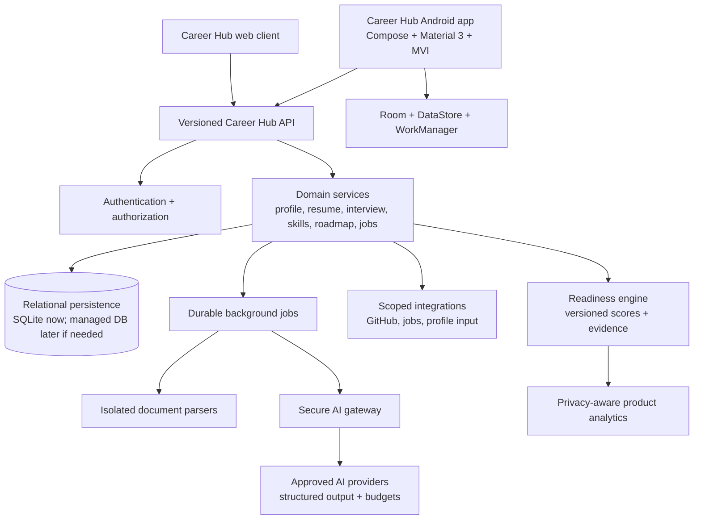

# Career Hub — Complete Product Audit, Development Roadmap & Execution Plan

**Product identity:** Career Hub  
**Repository:** `kabeesh395-oss/career`  
**Audit basis:** repository inspection, backend/client test results, Android configuration review, CI/release workflow review, and attempted APK build  
**Current audit status:** planning and verification completed; no implementation changes made during this audit  
**Scheduling assumption:** one senior full-stack/Android engineer supported by part-time QA/design review, 30 focused engineering hours per week. A two-person team can run selected backend, Android, and QA streams in parallel.

## 1. Executive assessment

Career Hub is an existing multi-surface project with three active technical surfaces: a Kotlin/Jetpack Compose Android application, an Express/TypeScript backend with SQLite, and a React/Vite client. It already contains substantial career functionality, including authentication, profiles, skills, career analysis, roadmaps, resume analysis, interviews, learning resources, projects, integrations, analytics, AI fallbacks, and local Android data persistence.

The project is not yet a release-ready career ecosystem. The largest gaps are not the number of screens; they are consistency, evidence quality, cross-surface contracts, release signing, product identity, security hardening, and the absence of several backend capabilities promised by the product vision.

The immediate Android installation issue is explainable from repository evidence:

1. The attempted local debug build did not produce an APK because the environment contains a Java 21 runtime but no Java compiler (`javac`). Gradle failed with `JAVA_COMPILER` missing before packaging.
2. The release workflow creates or decodes a keystore, but `app/build.gradle.kts` does not define a release signing configuration that uses it. A release APK produced without signing should not be distributed and may appear to Android as invalid.
3. The application label and multiple documentation/source strings still use legacy alternate branding. The official product identity must be normalized to **Career Hub** without changing the application ID casually.

## 2. Verified versus partial versus missing

| Area | Classification | Evidence | Decision |
|---|---|---|---|
| Android Compose application | Existing and substantial | About 60 Kotlin source files across screens, repositories, local data, remote clients, and theme | Preserve; stabilize and simplify navigation |
| Web client | Existing and buildable | React/Vite client; production build and 24 tests passed | Preserve; align with Android contracts |
| Backend API | Existing and buildable | Express routes for auth, profile, career, roadmap, resume, projects, interview, learning, integrations, analytics, readiness, and user deletion | Preserve; add missing domains through versioned contracts |
| Authentication | Existing and partially hardened | JWT/bcrypt/auth routes and tests | Add revocation, current-user validation, consent, and stricter auth throttling |
| Profile and skills | Existing | Profile, skills, goals, skill-gap tables/routes | Connect to evidence and readiness scoring |
| Resume intelligence | Existing and partially hardened | PDF/DOCX/TXT upload, parsing, ATS analysis, JD matching | Add versioning, comparison, output validation, and async processing |
| Interview preparation | Existing | Question generation, answer submission, scoring, history | Add longitudinal reporting, communication rubrics, and voice only after consent/design review |
| Learning roadmap | Existing | Roadmap generation, task toggling, learning resources/progress | Add evidence links, milestones, and reliable resource quality |
| GitHub intelligence | Partial | GitHub integration and repository service exist | Add scoped sync, evidence model, caching, and rate controls |
| AI career coach | Partial/not exposed as a complete product | AI services exist, but no complete grounded coach workflow is exposed | Build bounded context-aware coach after readiness foundation |
| Aptitude assessment | Missing | No aptitude routes or assessment tables | P1 implementation |
| Communication practice | Missing/partial | Interview feedback exists, but no dedicated exercise/history model | P1 implementation |
| Jobs/internships | Missing | No job source, job, saved opportunity, or application API | P2 implementation |
| LinkedIn guidance | Missing | Integration schema exists but no supported analysis workflow | P2; use compliant user-provided input first |
| Nine-pillar readiness | Partial | Existing dashboard score and new readiness snapshot foundation | Complete pillar evidence, history, and UI |
| Next Best Action | Existing and partially integrated | Existing recommendation service plus readiness action contract | Add completion state, ranking, and evidence updates |
| Android release packaging | Broken/unverified | Local build blocked by missing `javac`; release signing is not wired | P1 critical release blocker |
| Product branding | Inconsistent | App label, root metadata, theme names, comments, and strings contain legacy alternate names | P1 normalization; preserve application ID unless migration is approved |
| CI | Partial | Backend/client/security jobs exist; Android runs unit tests but not APK signing verification | Add APK build, signing, alignment, badging, and installability checks |

## 3. Product specification baseline

Career Hub should be organized around one user loop:

> **Understand current state → identify the highest-impact gap → complete one action → attach evidence → update readiness.**

The nine product modules are:

1. AI Career Coach
2. Resume Intelligence
3. Interview Preparation
4. Skill Intelligence
5. Learning Roadmap
6. Aptitude and Assessment
7. Portfolio Intelligence
8. Jobs and Internships
9. Career Readiness Intelligence

The product must distinguish between a measured score, an estimated compatibility indicator, and an unavailable signal. Resume analysis should be presented as an estimated ATS compatibility indicator, not as an exact score from an unknown proprietary hiring system. Interview feedback must not claim facial-emotion or psychological analysis without validated data, consent, and methodology. Job listings and application status must always come from legitimate sources or user actions; the system must not fabricate opportunities or statuses.

## 4. Target architecture

### Android

Preserve Kotlin, Compose, Material 3, repository patterns, Room, DataStore, and WorkManager. Introduce a feature contract pattern with `UiState`, `UiEvent`, `UiEffect`, and a repository boundary for each major module. Avoid a package-wide rename or application ID change until a release migration plan exists.

### Backend

Preserve Express/TypeScript for the current release. Keep route handlers thin, move scoring and domain rules into services, use strict Zod schemas with maximum sizes, and add a durable worker only for long-running parsing, AI, sync, and matching. Continue using parameterized queries and tenant-scoped access checks. A managed database migration is optional, not a prerequisite, if SQLite remains single-instance and properly backed up.

### AI gateway

All AI calls must pass through a backend gateway with prompt versioning, structured output schemas, provider timeouts, retries, budgets, redaction rules, cache keys, and fallback behavior. User-provided content must be treated as untrusted input. Each AI result must record model/prompt version, evidence references, confidence, and whether the result was generated by a deterministic fallback.

## 5. Backend and database plan

### Core new or expanded tables

- `consents`: user, data source, scope, version, granted/revoked timestamps.
- `readiness_snapshots`: versioned overall score, pillar scores, confidence, evidence coverage, source event.
- `readiness_evidence`: typed reference to resume, project, interview, assessment, learning, or integration evidence.
- `next_best_actions`: recommended action, pillar, ranking inputs, status, completion evidence, timestamps.
- `resume_versions`: stable version metadata and comparison lineage.
- `aptitude_questions`, `aptitude_sessions`, `aptitude_answers`, `aptitude_scores`.
- `communication_exercises`, `communication_attempts`, `communication_scores`.
- `github_syncs`, `github_repositories`, `github_evidence`.
- `job_sources`, `jobs`, `saved_jobs`, `job_matches`, `applications`.
- `ai_jobs`, `ai_usage_events`, `ai_prompt_versions`.

Every user-owned table requires a foreign key, a user-scoped index, deletion behavior, and an authorization test. Large text and external payloads must have explicit retention limits.

### API conventions

- `/api/v1` is the canonical public API; retain existing routes only as compatibility aliases.
- Every write returns a stable resource or job ID and a correlation ID.
- Long-running work returns `202 Accepted` with job status rather than blocking the request.
- Every expensive route has a per-user and per-IP quota.
- AI outputs are validated before persistence or display.
- List APIs use cursor pagination and select only required columns.

## 6. Phase-by-phase execution plan

### Phase 0 — Repository and Architecture Audit

**Objective:** Establish verified product, technical, security, and release baselines. **Priority:** Critical. **Duration:** 3–4 days. **Dependencies:** None. **Resources:** Android lead, backend lead, QA lead, product owner. **Affected areas:** `app/`, `server/`, `client/`, CI, docs.

**Tasks:** freeze the product name as Career Hub; create the implemented/partial/missing matrix; map Android navigation and backend routes; document data flows and secrets; inventory external dependencies; capture build/test baselines; identify release blockers; confirm user data and artifact retention.

**Acceptance:** every advertised feature has one of four evidence labels; every release blocker has an owner and task ID; architecture and data-flow diagrams are reviewed; no destructive changes are made.

**Testing:** baseline Android, backend, client, security, and packaging checks. **Risks:** false completeness caused by screens that are not wired to real data. **Mitigation:** require API/data/evidence verification. **Deliverables:** this audit, architecture diagram, feature matrix, baseline reports, prioritized board.

### Phase 1 — Critical Bugs and Build Stability

**Objective:** Make the project reproducibly buildable and stop release-blocking crashes. **Priority:** Critical. **Duration:** 1 week. **Dependencies:** Phase 0. **Resources:** Android engineer, CI owner.

**Tasks:** install/use a full JDK in all build environments; ensure Gradle wrapper mode is correct; wire explicit debug/release signing configurations; add APK `apksigner`, `zipalign`, `aapt badging`, and installability checks; remove stale fallback data and fake success states; fix manifest/resource/package consistency; add clean-build instructions.

**Affected:** `app/build.gradle.kts`, `codemagic.yaml`, `AndroidManifest.xml`, resource strings/themes, Gradle workflow.

**Acceptance:** debug APK builds locally; release APK builds in CI; APK is signed, aligned, parseable, and installable on an API 24 emulator and a current physical device; app label is Career Hub; CI archives the exact verified artifact.

**Testing:** clean Gradle build, unit tests, manifest merge, `apksigner verify`, `zipalign -c`, `aapt dump badging`, emulator install/launch. **Risks:** signing key loss or package ID changes. **Mitigation:** preserve application ID, use secure keystore secrets, document rotation. **Deliverables:** verified debug/release APKs and release build runbook.

### Phase 2 — Backend and Database Reliability

**Objective:** Make API persistence, migrations, jobs, and failures predictable. **Priority:** Critical. **Duration:** 1.5 weeks. **Dependencies:** Phase 0; Phase 1 for client release testing. **Resources:** backend engineer, QA.

**Tasks:** add schema migration/version tracking; fix configured database path usage; add transaction boundaries and idempotency; add composite indexes and pagination; introduce durable job records; add backup/restore and integrity checks; normalize error responses; add readiness/evidence tables and cleanup policies.

**Acceptance:** migration runs on empty and existing databases; restart does not lose jobs; backups restore into a clean environment; API latency and lock metrics have budgets; deletion removes all owned data.

**Testing:** migration tests, restart tests, lock/concurrency tests, backup restore, pagination, failure injection. **Risks:** SQLite lock contention. **Mitigation:** single writer boundary, WAL, bounded transactions, worker isolation.

### Phase 3 — Authentication and Security

**Objective:** Protect accounts, personal documents, integrations, and AI data. **Priority:** Critical. **Duration:** 1.5 weeks. **Dependencies:** Phase 2. **Resources:** backend/security/QA.

**Tasks:** add current-user lookup and token revocation; harden CORS; apply login/signup throttling; add consent and revocation; complete file/object deletion; add secret scanning and dependency gates; redact errors/logs; add IDOR and deleted-token tests; review Firebase/App Check and Firestore rules where used.

**Acceptance:** deleted or revoked accounts cannot use old tokens; every user-owned route passes isolation tests; no secrets or personal documents are tracked; provider scopes are minimal; audit logs omit sensitive payloads.

**Testing:** OWASP-oriented API tests, IDOR matrix, brute-force tests, malformed files, CORS, token rotation, dependency audit. **Risks:** lockout harming real users. **Mitigation:** progressive throttling, recovery flow, privacy-preserving messages.

### Phase 4 — AI Gateway and AI Integration

**Objective:** Make AI behavior structured, safe, measurable, and cost-controlled. **Priority:** Critical. **Duration:** 1.5 weeks. **Dependencies:** Phases 2–3. **Resources:** AI/backend engineer, product reviewer.

**Tasks:** centralize model calls; define schemas for resume, career, roadmap, interview, communication, and coach outputs; add prompt versions; add timeout/retry/fallback; add usage quotas and cache; sanitize/rescope user content; store evidence and confidence; add hallucination checks and human-readable uncertainty.

**Acceptance:** invalid model output never reaches persistence/UI; provider outages degrade gracefully; all AI responses identify model/fallback and prompt version; usage is measurable per user and feature.

**Testing:** contract fixtures, malformed JSON, provider timeout/outage, prompt injection, budget limits, deterministic fallback. **Risks:** incorrect recommendations. **Mitigation:** evidence citations, confidence, bounded actions, no fabricated claims.

### Phase 5 — Resume Intelligence

**Objective:** Deliver trustworthy resume creation, analysis, comparison, and job matching. **Priority:** High. **Duration:** 2 weeks. **Dependencies:** Phases 2–4. **Resources:** backend, Android/web, UX, QA.

**Tasks:** add resume version model; expose safe upload status jobs; parse in isolated workers; add ATS estimated compatibility language; add section/keyword/grammar checks; add JD comparison; add version diff and improvement checklist; add export; enforce no invented skills/metrics.

**Acceptance:** users can keep multiple versions, compare scores/evidence, and understand limitations; uploaded files are private and deletable; parser failures are recoverable; no exact proprietary ATS claim is shown.

**Testing:** PDF/DOCX/TXT fixtures, malformed/oversized files, parser timeout, version diff, offline upload retry, privacy deletion.

### Phase 6 — Interview Preparation

**Objective:** Build reliable interview practice and longitudinal feedback. **Priority:** High. **Duration:** 2 weeks. **Dependencies:** Phases 3–4. **Resources:** AI/backend, Android, UX, QA.

**Tasks:** separate HR/technical/role tracks; add session state recovery; add rubric versioning; add performance history; add communication exercises; add optional voice pipeline only with explicit permission; remove any unsupported psychological/facial claims.

**Acceptance:** a user can complete, resume, review, and compare sessions; scores cite rubric and answer evidence; privacy controls cover answer and audio retention.

**Testing:** session interruption, duplicate submissions, AI failure, audio permission denial, accessibility, score reproducibility.

### Phase 7 — Skill Intelligence and Career Analysis

**Objective:** Convert skills and target roles into explainable gaps and priorities. **Priority:** High. **Duration:** 1.5 weeks. **Dependencies:** Phases 2–4. **Resources:** backend/AI/product.

**Tasks:** normalize skill taxonomy; define beginner/intermediate/advanced levels; connect self-report, resume, project, GitHub, interview, and assessment evidence; version role requirements; explain current-versus-required levels; feed readiness and Next Best Action.

**Acceptance:** every gap references source evidence and role version; missing evidence is not treated as failure; recalculation is deterministic for the same version.

### Phase 8 — Personalized Learning Roadmap

**Objective:** Make roadmaps achievable, evidence-linked, and measurable. **Priority:** High. **Duration:** 1.5 weeks. **Dependencies:** Phase 7. **Resources:** backend, Android/web, content/QA.

**Tasks:** add daily/weekly/monthly planning; connect tasks to skills and evidence; add learning resource quality metadata; add completion proof; add streak/goal preferences; add overdue/replan behavior; keep only legitimate resources.

**Acceptance:** completing a task updates evidence and readiness; roadmap can be regenerated without destroying history; user can pause/replan; empty states are honest.

### Phase 9 — Aptitude and Assessment

**Objective:** Add quantitative, logical, verbal, technical, and coding assessment. **Priority:** High. **Duration:** 2 weeks. **Dependencies:** Phases 2, 4, 7. **Resources:** backend, content, Android, QA.

**Tasks:** create question bank metadata; add timed sessions; randomize safely; persist resumable attempts; score by topic/difficulty; show explanations; add weak-topic recommendations; integrate with readiness.

**Acceptance:** answer keys are not exposed before submission; sessions recover from network loss; scores are reproducible and versioned; test history is private.

### Phase 10 — GitHub and Portfolio Intelligence

**Objective:** Turn GitHub into evidence of practical skills rather than vanity metrics. **Priority:** High. **Duration:** 1.5 weeks. **Dependencies:** Phases 3, 7. **Resources:** backend, Android/web, QA.

**Tasks:** use minimal read-only scopes; add explicit connect/revoke; sync with caching and quotas; analyze README, tests, CI, license, deployment, activity, languages, forks, and completeness; allow project links; cite repository evidence.

**Acceptance:** sync is revocable, rate-limited, cached, and cancellable; recommendations cite repositories; provider failures are non-blocking.

### Phase 11 — Jobs and Internship Integration

**Objective:** Provide legitimate discovery, matching, saving, and application tracking. **Priority:** Medium. **Duration:** 2 weeks. **Dependencies:** Phases 3, 7, 10. **Resources:** backend/integration, product/legal review, QA.

**Tasks:** select one compliant provider or user-supplied job source; normalize/deduplicate jobs; add search/filter; save jobs; match skills/resume; add application statuses and external links; add deadline reminders; document source terms.

**Acceptance:** no fabricated listing/status; each job includes source and timestamp; provider limits are respected; application tracking is user-controlled.

### Phase 12 — Career Readiness Dashboard

**Objective:** Make Career Hub’s central value visible and actionable. **Priority:** Critical product milestone. **Duration:** 1.5 weeks. **Dependencies:** Phases 5–11 incrementally; readiness foundation already exists.

**Tasks:** complete nine-pillar evidence view; show score/confidence/history; show strengths/gaps; show target-role comparison; show one primary and three secondary actions; add action completion/evidence links; add honest onboarding and low-data states.

**Acceptance:** a new user sees no fabricated score; every score has evidence and timestamp; completing an action updates the dashboard; mobile and web layouts are accessible.

### Phase 13 — UI/UX Consistency and Performance

**Objective:** Make all surfaces feel like one coherent Career Hub product. **Priority:** High. **Duration:** 2 weeks, parallelizable from Phase 5. **Resources:** UX, Android, web, accessibility QA.

**Tasks:** normalize Career Hub branding; unify typography, spacing, status colors, card hierarchy, loading/error/empty states; simplify navigation to Home/Resume/Interviews/More; remove duplicate destinations; audit contrast, touch targets, semantics, animation cost, and offline behavior; reduce unnecessary gradients and fake metrics.

**Acceptance:** approved design tokens are used across primary flows; all screens have loading/error/empty states; no duplicate navigation destination; accessibility checks pass; startup and screen transition budgets are met.

### Phase 14 — Full Testing and Quality Assurance

**Objective:** Validate real user journeys, failure modes, privacy, and release regression. **Priority:** Critical. **Duration:** 2 weeks. **Dependencies:** feature phases substantially complete. **Resources:** QA lead, Android/backend/web engineers.

**Tasks:** add unit, integration, API, UI, offline, network-failure, security, performance, migration, and release tests; test real onboarding; test deletion/export; test AI provider outage; test parser abuse; test multiple users and roles; maintain a regression matrix.

**Acceptance:** all critical journeys pass on Android and web; no open critical/high release blockers; test reports are archived; known limitations are documented.

### Phase 15 — Release Preparation and APK Validation

**Objective:** Produce a signed, installable, traceable Career Hub release. **Priority:** Critical. **Duration:** 3–5 days. **Dependencies:** Phases 1 and 14. **Resources:** Android/release owner, QA.

**Tasks:** configure secure release signing; validate application label and version; build debug and release artifacts; run `apksigner verify --verbose`, `zipalign -c -v 4`, `aapt dump badging`; install on API 24, current Android emulator, and a physical device; test upgrade from prior version; archive checksums, mapping, test reports, and release notes.

**Acceptance:** artifact installs and launches; signing certificate is expected; package identity is stable; release artifact is named for Career Hub; CI blocks unsigned/unverifiable APKs.

## 7. Schedule and critical path

### Overall estimate

For one senior engineer with part-time QA/design support: **20–24 focused weeks** to reach a responsible public beta, assuming no large provider/legal delays. A two-person engineering team can reduce elapsed time to approximately **12–16 weeks** by parallelizing Android/UI and backend/integration work. This estimate excludes major redesign, paid data-provider procurement, and unplanned Firebase migration.

### Critical path

`Phase 0 → Phase 1 → Phase 2 → Phase 3 → Phase 4 → Phases 5/7 → Phase 12 → Phase 14 → Phase 15`

Phases 6, 8, 9, 10, and 13 can partially run in parallel after their dependencies are stable. Phase 11 should not block the readiness MVP.

### Week-by-week calendar

| Week | Focus | Milestone |
|---|---|---|
| 1 | Audit, identity, toolchain, APK signing diagnosis | Baseline and blockers approved |
| 2 | Build stability, release signing, CI packaging | Installable debug/release artifacts |
| 3 | Database migrations, backups, reliability | Repeatable persistence and restore |
| 4 | Auth, privacy, quotas, IDOR/security | Security gate passes |
| 5 | AI gateway contracts, schemas, budgets | Structured AI responses |
| 6–7 | Resume versions, parser jobs, JD comparison | Resume Intelligence beta |
| 8 | Skill taxonomy and evidence model | Explainable skill gaps |
| 9 | Learning roadmap evidence loop | Roadmap completion updates evidence |
| 10–11 | Interview longitudinal reporting and communication MVP | Interview readiness beta |
| 12–13 | Aptitude assessment MVP | Assessment evidence integrated |
| 14 | GitHub evidence intelligence | Portfolio evidence beta |
| 15–16 | Readiness dashboard and Next Best Action completion loop | Career Readiness MVP |
| 17 | UI/UX consistency and accessibility pass | Cross-surface design gate |
| 18 | Jobs/internships provider integration | Marketplace beta, optional for public MVP |
| 19–20 | Full QA, performance, privacy, upgrade testing | Release candidate |
| 21 | Release signing and APK validation | Signed release candidate |
| 22–24 | Beta feedback, fixes, documentation, launch review | Public beta decision |

### First development week — day-by-day

| Day | Tasks | Output |
|---|---|---|
| 1 | Confirm official branding scope; inventory screens/routes; freeze baseline commits; record environment/toolchain versions | Signed audit baseline |
| 2 | Install/activate full JDK; reproduce Android build; inspect manifest and package metadata; inspect CI release workflow | Root-cause report for invalid APK |
| 3 | Define release signing design; create Gradle/CI acceptance commands; map current navigation and duplicate destinations | Release packaging task specification |
| 4 | Map implemented/partial/missing features to backend/UI/data evidence; review auth, AI, data retention, and external scopes | Feature matrix and risk register |
| 5 | Review architecture and database proposal with product owner; create task board; define Phase 1 acceptance tests | Approval-ready Phase 1 plan |

## 8. Priority task board

| ID | Title | Phase | Priority | Estimate | Dependencies | Status |
|---|---|---:|---|---:|---|---|
| CH-001 | Approve official Career Hub brand inventory | 0 | Critical | 4h | None | Ready |
| CH-002 | Install full JDK and reproduce Android build | 1 | Critical | 3h | None | Ready |
| CH-003 | Wire explicit debug/release signing | 1 | Critical | 6h | CH-002 | Blocked by approval |
| CH-004 | Add APK signature/alignment/install CI gate | 1 | Critical | 5h | CH-003 | Backlog |
| CH-005 | Add database migration/version mechanism | 2 | Critical | 10h | CH-001 | Backlog |
| CH-006 | Fix configured database path behavior | 2 | High | 4h | CH-005 | Backlog |
| CH-007 | Add token revocation/current-user validation | 3 | Critical | 8h | CH-005 | Backlog |
| CH-008 | Add consent and data-source revocation | 3 | High | 10h | CH-005 | Backlog |
| CH-009 | Centralize structured AI gateway | 4 | Critical | 14h | CH-007 | Backlog |
| CH-010 | Add resume versions and comparison | 5 | High | 14h | CH-009 | Backlog |
| CH-011 | Add interview history/rubric versioning | 6 | High | 12h | CH-009 | Backlog |
| CH-012 | Normalize skill taxonomy and evidence | 7 | High | 12h | CH-009 | Backlog |
| CH-013 | Connect roadmap completion to evidence | 8 | High | 8h | CH-012 | Backlog |
| CH-014 | Build aptitude question/session model | 9 | High | 18h | CH-005, CH-012 | Backlog |
| CH-015 | Build communication practice MVP | 9 | High | 14h | CH-009 | Backlog |
| CH-016 | Add GitHub evidence sync | 10 | High | 14h | CH-007, CH-012 | Backlog |
| CH-017 | Complete readiness dashboard history/actions | 12 | Critical | 12h | CH-010–CH-016 | In progress foundation only |
| CH-018 | Normalize Android/web UI tokens and states | 13 | High | 18h | CH-001 | Backlog |
| CH-019 | Add full regression matrix | 14 | Critical | 16h | Feature phases | Backlog |
| CH-020 | Produce and validate signed release APK | 15 | Critical | 8h | CH-004, CH-019 | Blocked by toolchain/signing |

## 9. Quality strategy

Every feature must include unit tests for domain rules, integration tests for persistence and API behavior, UI tests for primary states, API validation tests, error/retry tests, offline/network-failure tests, security/authorization tests, and regression coverage.

The release matrix must cover: clean install, upgrade install, login, onboarding, profile persistence, resume upload/version comparison, career analysis, roadmap generation/completion, aptitude session recovery, interview completion, GitHub revoke/sync failure, job source failure, readiness recalculation, account deletion, offline start, provider outage, malformed AI output, low-storage behavior, and Android back/navigation behavior.

Quality gates are:

- No fabricated data, progress, jobs, scores, or success messages.
- No unhandled crash in primary navigation.
- No leaked API keys or personal documents.
- No cross-user access.
- No unsupported AI claims.
- No unsigned or unverified release artifact.
- No open critical security issue.

## 10. Risk register

| Risk | Impact | Likelihood | Mitigation |
|---|---|---:|---|
| Unsigned/invalid APK | Release blocked | High | Explicit signing config, CI verification, emulator/physical install gate |
| JRE-only local environment | Development blocked | High | Standardize full JDK 21 toolchain and print `java/javac` diagnostics in CI |
| Branding migration breaks package identity | Upgrade/install failure | Medium | Change user-facing label/docs first; preserve application ID; plan migration separately |
| AI hallucinated career claims | User harm/trust loss | Medium | Structured schemas, evidence, confidence, grounded prompts, fallback labels |
| Resume/voice privacy exposure | High legal/reputation risk | Medium | Consent, retention, encryption, deletion, isolated parsing, minimal scopes |
| External API rate limits | Feature outages | High | Caching, quotas, retries, provider status, user-triggered sync |
| SQLite lock/contention | Latency/data errors | Medium | WAL, single writer, bounded transactions, worker jobs, backup plan |
| Scope expansion across 9 modules | Schedule slip | High | Readiness MVP first; defer jobs/LinkedIn until core loop is stable |
| Fake or stale job listings | User harm | Medium | Compliant provider, source timestamp, deduplication, no fabrication |
| Package/branding legacy strings | Review/release inconsistency | High | Identity inventory and automated string scan |
| Incomplete UI state handling | User confusion | Medium | Shared loading/error/empty state components and UI tests |

## 11. Cost and free-tier assumptions

The engineering estimate assumes existing repository ownership, free/open-source build tools, one backend deployment, and no paid data provider contract. The first beta can remain low-cost if it uses SQLite on a single controlled backend, conservative AI quotas, cached GitHub calls, user-supplied job descriptions, and text-first communication practice.

Likely cost drivers are AI inference, document parsing at scale, durable storage/backups, job data licensing, email/push notifications, observability retention, and voice processing. Before enabling those features, measure cost per active user and set hard monthly/user budgets. Current vendor pricing and free-tier limits must be rechecked at procurement time; no fixed price is assumed in this plan.

## 12. Release-readiness checklist

### Product and brand

- [ ] Every user-facing surface says Career Hub.
- [ ] Launcher label, splash, onboarding, dashboard, docs, README, release notes, APK filename, and support copy are consistent.
- [ ] Legacy alternate branding is removed from user-facing strings and automated scans.

### Android build

- [ ] Full JDK 21 with `javac` is available locally and in CI.
- [ ] Application ID remains stable unless a migration is deliberately approved.
- [ ] Debug and release signing configurations are explicit.
- [ ] Release keystore is injected securely, never committed.
- [ ] `apksigner verify --verbose` passes.
- [ ] `zipalign -c -v 4` passes.
- [ ] `aapt dump badging` shows the expected package, label, version, and launcher activity.
- [ ] APK installs on API 24 emulator, current emulator, and physical device.
- [ ] Upgrade from the previous installed version works.
- [ ] SHA-256 checksum and provenance are archived.

### Backend and AI

- [ ] Database migration and backup restore pass.
- [ ] Authentication, revocation, IDOR, deletion, and consent tests pass.
- [ ] AI schemas, timeouts, quotas, fallback, and prompt versions are active.
- [ ] Upload parsers are isolated and cleanup is verified.
- [ ] Provider keys are not in Android or public repository.
- [ ] Job and GitHub sources are legitimate, scoped, cached, and rate-limited.

### QA and operations

- [ ] Backend build, security, QA, phase, and load tests pass.
- [ ] Client build and tests pass.
- [ ] Android unit/instrumentation/UI tests pass.
- [ ] Offline and network-failure flows pass.
- [ ] Crash/error monitoring and correlation IDs are configured.
- [ ] Rollback, support, privacy, and incident runbooks are current.
- [ ] No critical/high release blocker remains without explicit acceptance.

## 13. Immediate next action after approval

The first implementation phase should fix the release blocker before adding new product modules:

1. Provision a full JDK 21 and reproduce `assembleDebug`.
2. Add an explicit signing configuration for debug and release without changing the application ID.
3. Add CI artifact verification and a device install smoke test.
4. Normalize the launcher label and user-facing product branding to Career Hub.
5. Rebuild, inspect, and attach the verified APK.

No major implementation changes were made while preparing this plan. The repository currently has only the pre-existing untracked audit report; no new source changes were added in this audit pass.
